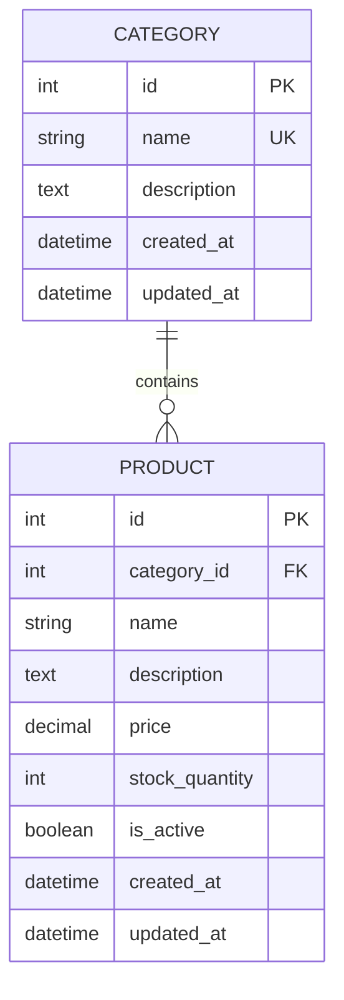

# E-Commerce Product API

[](https://github.com/anaol216/ALX_Django_Final/actions/workflows/ci.yml)

A robust, production-ready RESTful E-Commerce Product and Category API built with **Django 5** and **Django REST Framework (DRF)**. This application provides full CRUD capabilities, relational data integrity, clean architecture, automated testing, containerization, and continuous integration via GitHub Actions.

---

## Table of Contents

- [Architecture & Design](#architecture--design)
  - [Project Structure](#project-structure)
  - [Data Models](#data-models)
- [Prerequisites](#prerequisites)
- [Local Setup & Installation](#local-setup--installation)
  - [1. Clone Repository](#1-clone-repository)
  - [2. Virtual Environment Setup](#2-virtual-environment-setup)
  - [3. Install Dependencies](#3-install-dependencies)
  - [4. Environment Variables Configuration](#4-environment-variables-configuration)
- [Database Migrations](#database-migrations)
- [Running the Application](#running-the-application)
- [API Endpoints Reference](#api-endpoints-reference)
  - [Categories Endpoints](#categories-endpoints)
  - [Products Endpoints](#products-endpoints)
  - [Example Payloads](#example-payloads)
- [Testing & Quality Checks](#testing--quality-checks)
- [Continuous Integration (GitHub Actions)](#continuous-integration-github-actions)
- [Docker Setup & Deployment](#docker-setup--deployment)
- [Postman Setup & Usage](#postman-setup--usage)
- [Security & Environment Guidelines](#security--environment-guidelines)

---

## Architecture & Design

The project follows standard Django modular architecture with clean separation of concerns:
- **Presentation Layer**: Django REST Framework generic class-based views (`generics.ListCreateAPIView`, `generics.RetrieveUpdateDestroyAPIView`).
- **Serialization Layer**: ModelSerializers validating incoming payload schemas, field types, and relational foreign keys.
- **Data Persistence Layer**: Django ORM with models for `Category` and `Product`. Foreign key relationship enforces `on_delete=models.PROTECT` to prevent accidental orphaned product records.
- **Configuration Management**: 12-factor configuration powered by `django-environ` reading `.env` files while falling back to safe defaults during local development and testing.

### Project Structure

```text
ALX_Django_Final/
├── .github/
│   └── workflows/
│       └── ci.yml               # GitHub Actions CI workflow
├── config/
│   ├── __init__.py
│   ├── asgi.py
│   ├── settings.py              # App settings with django-environ
│   ├── urls.py                  # Root URL configuration
│   └── wsgi.py
├── products/
│   ├── migrations/              # Database migration files
│   ├── __init__.py
│   ├── admin.py                 # Django admin registration
│   ├── apps.py
│   ├── models.py                # Category and Product ORM models
│   ├── serializers.py           # DRF ModelSerializers
│   ├── tests.py                 # Automated model and API tests
│   ├── urls.py                  # Products and categories API routing
│   └── views.py                 # DRF generic API views
├── .dockerignore                # Docker build ignore rules
├── .env.example                 # Environment variables template
├── .gitignore                   # Git ignore file
├── docker-compose.yml           # Docker Compose service definition
├── Dockerfile                   # Docker container specification
├── manage.py                    # Django management script
├── postman_collection.json      # Postman API test collection
├── pytest.ini                   # Pytest configuration
├── README.md                    # Project documentation
└── requirements.txt             # Python dependencies
```

### Data Models



---

## Prerequisites

Ensure you have the following installed on your machine:
- **Python 3.11+**
- **pip** (Python package manager)
- **Git**
- *(Optional)* **Docker** and **Docker Compose** (for containerized execution)
- *(Optional)* **Postman** (for API request testing)

---

## Local Setup & Installation

### 1. Clone Repository

```bash
git clone https://github.com/anaol216/ALX_Django_Final.git
cd ALX_Django_Final
```

### 2. Virtual Environment Setup

- **On macOS/Linux:**
  ```bash
  python3 -m venv venv
  source venv/bin/activate
  ```

- **On Windows (PowerShell):**
  ```powershell
  python -m venv venv
  .\venv\Scripts\Activate.ps1
  ```

- **On Windows (Command Prompt):**
  ```cmd
  python -m venv venv
  venv\Scripts\activate.bat
  ```

### 3. Install Dependencies

```bash
pip install --upgrade pip
pip install -r requirements.txt
```

### 4. Environment Variables Configuration

Copy the sample environment template `.env.example` to create your local `.env`:

- **On macOS/Linux:**
  ```bash
  cp .env.example .env
  ```

- **On Windows:**
  ```powershell
  copy .env.example .env
  ```

Environment variables explained:

| Variable | Description | Default (Dev) |
|---|---|---|
| `SECRET_KEY` | Django cryptographic signing secret | Safe dev string |
| `DEBUG` | Enables/disables debug mode (`True` / `False`) | `True` |
| `ALLOWED_HOSTS` | Comma-separated list of allowed hostnames | `127.0.0.1,localhost` |
| `DATABASE_URL` | Database connection URL (SQLite or PostgreSQL) | `sqlite:///db.sqlite3` |

> [!WARNING]
> Never commit `.env` or sensitive credentials to version control. `.env` is included in `.gitignore` by default.

---

## Database Migrations

Apply database migrations to set up your database schema:

```bash
python manage.py migrate
```

If you make modifications to `products/models.py`, generate and verify new migrations:

```bash
# Check for pending changes
python manage.py makemigrations --dry-run

# Create migration files
python manage.py makemigrations

# Apply migrations
python manage.py migrate
```

To create an administrative user for the Django Admin interface:

```bash
python manage.py createsuperuser
```

---

## Running the Application

Start the local Django development server:

```bash
python manage.py runserver
```

The server will start at `http://127.0.0.1:8000/`.

- **API Base URL**: `http://127.0.0.1:8000/api/`
- **Django Admin Interface**: `http://127.0.0.1:8000/admin/`

---

## API Endpoints Reference

All endpoints return and accept JSON.

### Categories Endpoints

| Method | Endpoint | Description |
|---|---|---|
| `GET` | `/api/categories/` | List all product categories |
| `POST` | `/api/categories/` | Create a new category |
| `GET` | `/api/categories/<id>/` | Retrieve category details by ID |
| `PUT` | `/api/categories/<id>/` | Update all category fields |
| `PATCH` | `/api/categories/<id>/` | Partially update a category |
| `DELETE` | `/api/categories/<id>/` | Delete a category (restricted if products exist) |

### Products Endpoints

| Method | Endpoint | Description |
|---|---|---|
| `GET` | `/api/` | List all products |
| `POST` | `/api/` | Create a new product |
| `GET` | `/api/<id>/` | Retrieve product details by ID |
| `PUT` | `/api/<id>/` | Update all product fields |
| `PATCH` | `/api/<id>/` | Partially update a product |
| `DELETE` | `/api/<id>/` | Delete a product |

### Example Payloads

#### 1. Create Category (`POST /api/categories/`)

**Request Body:**
```json
{
  "name": "Electronics",
  "description": "Smartphones, laptops, and consumer electronic accessories"
}
```

**Response (`201 Created`):**
```json
{
  "id": 1,
  "name": "Electronics",
  "description": "Smartphones, laptops, and consumer electronic accessories",
  "created_at": "2026-11-18T22:00:00Z",
  "updated_at": "2026-11-18T22:00:00Z"
}
```

#### 2. Create Product (`POST /api/`)

**Request Body:**
```json
{
  "category": 1,
  "name": "Wireless Noise-Canceling Headphones",
  "description": "High-fidelity Bluetooth headphones with active noise cancellation",
  "price": "149.99",
  "stock_quantity": 50,
  "is_active": true
}
```

**Response (`201 Created`):**
```json
{
  "id": 1,
  "category": 1,
  "category_name": "Electronics",
  "name": "Wireless Noise-Canceling Headphones",
  "description": "High-fidelity Bluetooth headphones with active noise cancellation",
  "price": "149.99",
  "stock_quantity": 50,
  "is_active": true,
  "created_at": "2026-11-18T22:01:00Z",
  "updated_at": "2026-11-18T22:01:00Z"
}
```

---

## Testing & Quality Checks

The project includes unit and integration tests covering models, serializers, constraints, and API views.

### Run Tests via Django Test Runner
```bash
python manage.py test
```

### Run Tests via Pytest
```bash
pytest
```

### Run Django System Checks
```bash
python manage.py check
```

### Verify No Missing Migrations
```bash
python manage.py makemigrations --check --dry-run
```

---

## Continuous Integration (GitHub Actions)

A GitHub Actions CI workflow is configured in `.github/workflows/ci.yml`.

### Workflow Triggers
- Every `push` to `main` or `master`
- Every `pull_request` targeting `main` or `master`

### Pipeline Steps
1. **Repository Checkout**: Pulls repository code using `actions/checkout@v4`.
2. **Python Setup**: Sets up Python 3.11 with pip caching enabled via `actions/setup-python@v5`.
3. **Dependency Installation**: Upgrades pip and installs `requirements.txt`.
4. **Django System Check**: Runs `python manage.py check` to catch misconfigurations.
5. **Pending Migrations Check**: Runs `python manage.py makemigrations --check --dry-run` to detect uncommitted model schema changes.
6. **Apply Migrations**: Runs `python manage.py migrate --no-input`.
7. **Execute Test Suite**: Runs automated tests with `python manage.py test`.

### CI Security & Safe Environment Variables
The workflow uses safe test environment variables that do not expose credentials:
```yaml
env:
  SECRET_KEY: ${{ secrets.SECRET_KEY || 'django-insecure-ci-test-key-for-github-actions-runs-12345' }}
  DEBUG: 'True'
  ALLOWED_HOSTS: 'localhost,127.0.0.1,testserver'
  DATABASE_URL: 'sqlite:///db.sqlite3'
```
No private credentials or `.env` files are required for CI to pass.

---

## Docker Setup & Deployment

You can run the entire application inside Docker containers using Docker Compose or Docker CLI.

### Using Docker Compose (Recommended)

1. **Build and start container:**
   ```bash
   docker compose up --build
   ```
   The application will be accessible at `http://localhost:8000`.

2. **Run migrations inside container:**
   ```bash
   docker compose exec web python manage.py migrate
   ```

3. **Run tests inside container:**
   ```bash
   docker compose exec web python manage.py test
   ```

4. **Stop containers:**
   ```bash
   docker compose down
   ```

### Using Standalone Docker CLI

1. **Build Docker image:**
   ```bash
   docker build -t ecommerce-api .
   ```

2. **Run container:**
   ```bash
   docker run -d -p 8000:8000 --name ecommerce-api-container ecommerce-api
   ```

---

## Postman Setup & Usage

A pre-configured Postman collection is included in the root of the project: `postman_collection.json`.

### How to Import and Use:
1. Open **Postman**.
2. Click **Import** (top left).
3. Drag and drop `postman_collection.json` or browse to select it.
4. The **E-Commerce Product API** collection will appear in your sidebar.

### Collection Variables:
The collection includes pre-defined variables:
- `base_url`: Defaults to `http://localhost:8000`
- `category_id`: Defaults to `1`
- `product_id`: Defaults to `1`

### Suggested Request Execution Flow:
1. **Categories > Create Category**: Creates a category (e.g. `Electronics`).
2. **Categories > List Categories**: Confirms the category is returned with ID `1`.
3. **Products > Create Product**: Creates a product associated with `category: 1`.
4. **Products > List Products**: Verifies product listing and nested `category_name`.
5. **Products > Get Product Detail**: Fetches the created product by ID.
6. **Products > Update Product**: Updates product price, name, or stock.
7. **Products > Delete Product**: Removes the product.
8. **Categories > Delete Category**: Removes the category once products are deleted.

---

## Security & Environment Guidelines

- **Never Commit Secrets**: Ensure `.env` is listed in `.gitignore` and never committed to Git.
- **Production Secret Key**: In staging or production, generate a cryptographically strong secret key using `python -c "import secrets; print(secrets.token_urlsafe(50))"`.
- **Debug Mode**: Always set `DEBUG=False` in production environments.
- **Allowed Hosts**: Explicitly configure `ALLOWED_HOSTS` to match your domain or server IP in production.
